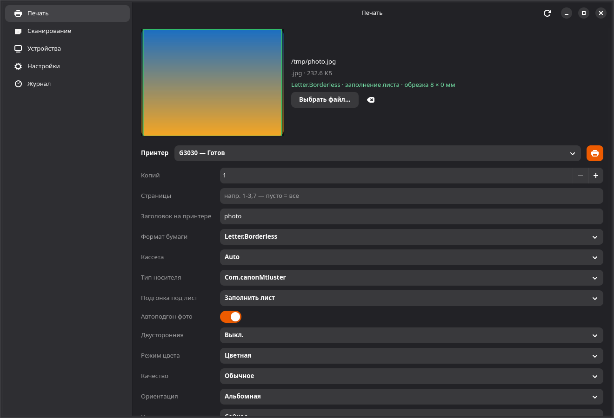
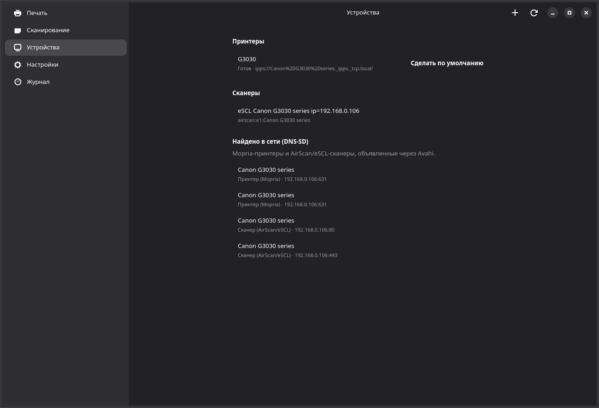
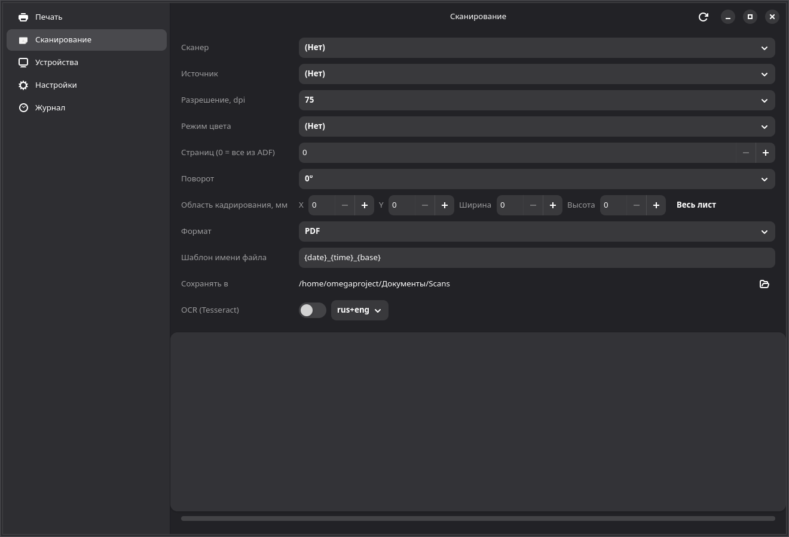
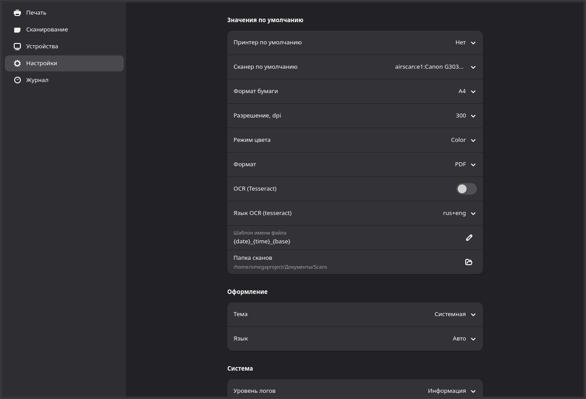

# LinuxPrinterG

<p align="center"></p>

[Русский](README.ru.md)

**A fast, minimal print and scan center for Linux.**

LinuxPrinterG works with printers and scanners through the standard Linux
system services — **CUPS** (`lp`, `lpstat`, `cancel`, `lpoptions`) and **SANE**
(`scanimage`, including the `escl` backend for AirScan/eSCL) — and uses the
drivers already installed on the system. The application **ships no proprietary
drivers of its own** and requires no root privileges: printers are added with the
system wizard (`system-config-printer`) or the CUPS web interface, which request
the polkit authorization themselves.

Target distributions: Ubuntu 24.04+, Fedora 40+, Debian 13+, Arch Linux.
Runs on Wayland and X11. Themes: light, dark, system. Interface: Russian and
English.

---

## Features

### Printing
* printer selection, drag-and-drop and file picking: **PDF, images** —
  directly; **WebP** — automatically assembled into a PDF via the image
  encoder (not all CUPS filters understand WebP); **DOCX/ODT/RTF** —
  optional conversion through LibreOffice headless (if installed), otherwise a
  clear hint;
* preview: images are shown directly, PDFs are rendered as the first page
  via `pdftoppm` (poppler-utils);
* options: copies, page range (`1-3,7`), paper size, orientation,
  margins (via driver CUPS options), color/B&W, duplex, quality, paper tray,
  media type — the lists are filled from the printer's **real**
  options (`lpoptions -p … -l`) with safe defaults;
  **delayed printing** — "Now / Morning / Evening / Night / Weekend"
  (`job-hold-until`; named values are checked against the printer options);
* print queue: jobs (active and recently completed), size,
  owner, **exact IPP status** ("processing", "paused",
  "completed", "failed" …) via a built-in IPP client with a fallback to `lpstat`,
  job cancellation (with confirmation); **Hold/Release/Restart-Job
  operations over IPP**: pause/resume of active jobs and restart of
  finished ones (buttons in the queue, confirmation, journal
  entry); **auto-refresh every 3 s** (stops after repeated failures,
  resumes with the "Refresh" button);
* **job completion notification**: a poller tracks active jobs and,
  when one reaches a terminal state, sends a system notification
  (freedesktop Notifications, D-Bus via `gio::Notification`) and a
  journal entry; active job counter — a badge in the sidebar ("Printing");
* **one-click photo profile**: "Photo" quality, color, single-sided
  printing and photo paper — if the printer reports a media type;
* **"Photo 4×6 / 10×15" photo size preset**: the same photo profile + sheet
  size; the aliases `4x6`/`10x15`/`100x150` are matched against the printer's
  real media list (exact match → borderless → any substring);
  if the size is missing, an honest message is shown and the size is left
  unchanged;
* **fit-to-page** (`print-scaling`: auto/fit/fill/no
  scaling) — the list is filled from the printer options; it is
  sent only if the printer advertises the option, otherwise "default"
  (nothing is sent);
* **auto photo fit** (Canon PRINT-style): the paper format is picked to
  match the aspect ratio of the photo (including `.Borderless` formats and
  landscape orientation), the sheet is then filled with cropping (`fill`)
  or safely fitted; a summary line appears under the preview
  (“4x6.Borderless · fills the sheet · crop 13 × 0 mm”) and the preview
  itself shows the crop live: dark bands over the cropped edges and a green
  frame around the printed area; the choice is remembered between runs;
* files open from outside: `linuxprinterg photo.jpg` and “Open With” from
  the file manager (MIME types in the `.desktop` file, `HANDLES_OPEN`);

### Scanning
* scanner selection (USB, network, AirScan/eSCL via the `escl` backend);
* source (Flatbed / ADF / ADF Duplex — if advertised by the scanner), resolution,
  color mode — lists from `scanimage --help`;
* multi-page scanning with ADF (including "all pages" with an infinite-loop
  guard), progress per page **and in percent**
  (`scanimage --progress` is read as a stream from stderr), cancellation at any
  time;
* cropping (area in mm, clipped to the device bounds) and rotation 0/90/180/270°;
* saving: **PDF** (multi-page, own PDF writer: zlib for
  raster, DCTDecode for JPEG — no re-encoding), **TIFF** (a single
  multi-page file: own writer, IFD chain + Adobe Deflate,
  verified with libtiff and Pillow), PNG, JPEG, WebP;
* file name template (`{base} {device} {date} {time} {page} {n} {ext}`) with
  sanitization and a uniqueness guarantee;
* optional **OCR via Tesseract** with language selection (a separate .txt).

### Devices
* printer list (state, URI, default printer) and scanner list;
* device properties — URI, state and **driver ICC profiles** from the PPD
  (`*cupsICCProfile`): the PPD is downloaded with an anonymous GET from the
  local cupsd (works even without membership in the `lp`
  group), the profiles are shown with a note that they are
  applied automatically by the CUPS stack — choosing an arbitrary ICC file
  via `lp` is supported by neither CUPS nor the IPP specification, so
  the application does not invent anything;
* setting the default printer for the user
  (`lpoptions -d`, no root);
* "Add Printer": `system-config-printer` → CUPS web interface
  (`http://localhost:631/admin`) → text instructions;
* **network discovery via DNS-SD** (Avahi, `avahi-browse -rtp`): network
  Mopria printers (`_ipp/_ipps._tcp`) and AirScan/eSCL scanners
  (`_uscan/_uscans._tcp`) in a separate "Found on the network" group in addition
  to the CUPS/SANE lists; parallel browses, dedup, Avahi not
  installed — a clear hint instead of an error;
* a banner when the CUPS service is stopped/unavailable.

### Settings
* default printer and scanner, default print and scan options;
* theme (system/light/dark), language (auto/RU/EN), scans folder,
  log level, open logs folder, reset settings (with confirmation);
* storage — JSON in XDG directories (`~/.config/linuxprinterg`,
  `~/.local/state/linuxprinterg`), atomic writes.

### Journal
* operation history: printing, scanning, system events, errors,
  paths of saved files; auto-refresh, **category filter**,
  export to **CSV** (RFC 4180, opens in LibreOffice/Excel) or a
  plain text file, clearing (with confirmation).

### Reliability
* the UI never blocks: all external calls run in background threads with the
  result delivered to the GTK main loop;
* hard timeouts and cancellation (kill) for `lp`, `scanimage`, `tesseract`,
  `soffice`, `pdftoppm`;
* clear errors with instructions on "what to install" (cups-client, sane-backends,
  tesseract, poppler-utils, libreoffice);
* all potentially destructive actions require confirmation (job cancellation,
  journal clearing, settings reset).

### Accessibility
* full keyboard control (every widget is a standard GTK4 widget),
  accelerators `Ctrl+1..5`, `Ctrl+R`, `Ctrl+Q`;
* labels/tooltips for screen readers (GTK/AT-SPI), dark/light theme,
  readable contrast (Adwaita palette);
* adaptivity: in narrow windows (< 760 px) the sidebar collapses
  into a slide-over (`AdwOverlaySplitView`).

---

## Gallery

| Printing | Devices |
| :---: | :---: |
|  |  |

| Scanning | Settings |
| :---: | :---: |
|  |  |

---

## Architecture

A workspace of two crates — the logic is separated from the UI and fully
testable without a graphical environment:

```
linuxprinterg/
├── Cargo.toml                      # workspace (edition 2024, Rust ≥ 1.85)
├── Makefile                        # build, tests, packaging
├── rustfmt.toml
├── .github/workflows/ci.yml        # fmt + clippy + test + build + deb/rpm + flatpak
├── LICENSE                         # MIT
├── README.md
├── packaging/
│   ├── nfpm.yml                    # .deb/.rpm description (nfpm)
│   ├── postinstall.sh              # desktop/icon caches
│   ├── preremove.sh
│   └── linuxprinterg.spec          # alternative RPM build (rpmbuild)
├── scripts/
│   ├── render-icons.py             # SVG → hicolor (librsvg + cairo)
│   ├── get-nfpm.sh                 # download nfpm into target/tools
│   ├── build-packages.sh           # build .deb and .rpm
│   └── setup-fedora-dev-prefix.sh  # GTK prefix for a rootless sandbox
└── crates/
    ├── linuxprinterg-core/         # CORE (no GTK)
    │   ├── Cargo.toml
    │   └── src/
    │       ├── lib.rs
    │       ├── error.rs            # Error + localized messages/instructions
    │       ├── i18n.rs             # RU/EN dictionary, tr()/trf()
    │       ├── logging.rs          # tracing: stderr + rotating file
    │       ├── domain/
    │       │   ├── mod.rs          # Printer, Scanner, Job, print/scan requests
    │       │   └── page_range.rs   # "1-3,7" → ranges (+tests)
    │       ├── services/
    │       │   ├── proc.rs         # safe process execution: no shell,
    │       │   │                    #   timeout, cancellation (CancelHandle), LC_ALL=C
    │       │   ├── cups.rs         # lpstat/lp/cancel/lpoptions: collection+parsers
    │       │   ├── ipp.rs          # mini IPP client (HTTP POST to CUPS): exact
    │       │   │                    #   job statuses, manual RFC8010 encoding
    │       │   ├── sane.rs         # scanimage -L/--help/scan, ADF, crop-clip
    │       │   ├── pdf.rs          # multi-page PDF writer (Flate/DCT)
    │       │   ├── save.rs         # PNG/JPEG/TIFF/WebP
    │       │   ├── ocr.rs          # tesseract (language is sanitized)
    │       │   ├── convert.rs      # soffice --headless → PDF
    │       │   ├── preview.rs      # pdftoppm: first PDF page → PNG
    │       │   └── naming.rs       # name templates, uniqueness, sanitization
    │       └── storage/
    │           ├── mod.rs          # XDG paths, atomic writes
    │           ├── settings.rs     # Settings (serde) + validation
    │           └── journal.rs      # JournalHandle: log, export, cap 1000
    └── linuxprinterg/              # UI (GTK4 4.14+ / libadwaita 1.5+)
        ├── Cargo.toml
        ├── data/
        │   ├── org.linuxprinterg.LinuxPrinterG.desktop
        │   ├── org.linuxprinterg.LinuxPrinterG.metainfo.xml
        │   ├── org.linuxprinterg.LinuxPrinterG.flatpak.yml
        │   └── icons/              # app icon (SVG source + hicolor)
        └── src/
            ├── main.rs             # load settings → logs → i18n → start
            ├── app.rs              # AdwApplication, APP_ID, accelerators
            ├── window.rs           # OverlaySplitView, lazy pages, confirm()
            ├── ctx.rs              # AppCtx: settings, journal, toasts, device cache
            ├── tasks.rs            # bridge "blocking task → GTK main thread"
            └── pages/
                ├── mod.rs
                ├── print.rs        # print: files, DnD, preview, queue
                ├── scan.rs         # scan: options, preview, PDF/OCR
                ├── devices.rs      # printers/scanners, add, properties
                ├── settings.rs     # settings (PreferencesPage)
                └── journal.rs      # journal with auto-refresh and export
```

**Data flow.** UI → `tasks::run_async` (std::thread) → `linuxprinterg-core`
(synchronous utility calls with timeouts) → `async-channel` → the GTK main
thread (`glib::MainContext::spawn_local`). Cancellation goes through
`CancelHandle` (`Arc` + `Weak` to the child process, killed on request from the
UI).

---

## Dependencies

System packages (all target distributions):

| Purpose | Debian/Ubuntu | Fedora | Arch |
|---|---|---|---|
| Printing | `cups-client`, `cups` | `cups-client`, `cups` | `cups`, `cups-client` |
| Scanning | `sane-utils` | `sane-backends` | `sane` |
| AirScan/eSCL | `sane-airscan` | `sane-airscan` | `sane-airscan` |
| PDF preview | `poppler-utils` | `poppler-utils` | `poppler` |
| OCR (optional) | `tesseract-ocr`, `tesseract-ocr-rus` | `tesseract`, `tesseract-langpack-rus` | `tesseract`, `tesseract-data-rus` |
| DOCX→PDF (optional) | `libreoffice` | `libreoffice*` | `libreoffice-still` |

To build the UI: `libgtk-4-dev >= 4.14` and `libadwaita-1-dev >= 1.5`
(Debian/Ubuntu) or `gtk4-devel`, `libadwaita-devel` (Fedora),
`gtk4`, `libadwaita` (Arch). Rust **1.85+** (edition 2024).

---

## Build and run

```bash
# debug build and run
cargo run --release --workspace

# or via the Makefile
make build     # cargo build --workspace
make run       # cargo run --release
make release   # optimized build (LTO, strip)

# No GTK dev packages and no root (sandbox)? Extract them into a prefix:
scripts/setup-fedora-dev-prefix.sh
export PKG_CONFIG_PATH="/tmp/gtkprefix/usr/lib64/pkgconfig:/tmp/gtkprefix/usr/share/pkgconfig"
export RUSTFLAGS="-L /tmp/gtkprefix/usr/lib64"
```

## Tests and quality

```bash
make test       # cargo test --workspace        (core unit tests)
make test-int   # integration: real lpstat/scanimage/pdftoppm
make fmt-check  # rustfmt
make clippy     # clippy -D warnings
```

Covered by tests: the `lpstat`/`lpoptions`/`scanimage -L/--help` parsers
(fixtures of real output), queue job parsing (active/completed),
the whole IPP client — Get-Jobs encoding with roundtrip parsing, a fixture of a
**captured libcups request**, response group and `job-state` (enum
0x23) parsing, HTTP framing by Content-Length, CUPS server names, a live test
against a running CUPS (`cargo test -- --ignored`), streaming stderr
output (progress callbacks), `scanimage --progress` percentage,
page ranges, PDF
structure (xref correctness is verified programmatically and by rendering with
`pdftoppm`), name templates/path sanitization, the journal (text and CSV export
with RFC 4180 escaping and a category filter), settings (serde + validation),
process timeouts/cancellation, OCR language sanitization, i18n (RU/EN dictionary
completeness), multi-page TIFF (IFD chain structure, lossless pixel
roundtrip, gray/RGB), building a PDF from a WebP file, IPP job operations
(encoding/roundtrip of our own requests, a live test rejecting a
non-existent job), the delayed-print option and the DNS-SD/avahi-browse parser
(format of `=;…;host;addr;port` lines, name escaping, type classification),
fit-to-page `print-scaling` (advertised/not advertised/invalid
value, empty value), the PPD ICC profile parser (base format strings from
CUPS PPD Extensions and localized `*xx.` strings from real HP PPDs,
deduplication), percent-encoding of the PPD path and a live test downloading the
PPD with an anonymous GET, gettext formats (POT/PO skeleton
generation, parsing comments/`#, fuzzy`/multi-line strings/escapes, binary
MO roundtrip in LE and BE with structure verification, MO header
record) and overlay translation loading with fallback to EN when the .mo is
missing.

## Packaging

```bash
# .deb and .rpm — via nfpm (no dpkg-deb/rpmbuild, no root).
# The nfpm binary is downloaded once into target/tools (network required).
make deb        # dist/linuxprinterg_<version>_amd64.deb
make rpm        # dist/linuxprinterg-<version>-1.x86_64.rpm
make packages   # both packages at once

# Flatpak (see the "Flatpak limitations" section)
make flatpak

# AppImage: linuxdeploy with the GTK plugin
linuxdeploy --appdir AppDir -e target/release/linuxprinterg \
  --plugin gtk --output appimage

# System install
sudo make install   # binary + .desktop + metainfo + hicolor icons
```

Contents of `.deb`/`.rpm`: the binary, `.desktop`, metainfo, hicolor
icons (16/24/32/48/64/128/256 + scalable SVG), license. Hard dependencies
(`gtk4`/`libgtk-4-1` ≥ 4.14, `libadwaita`/`libadwaita-1-0` ≥ 1.5, `cups-client`,
`poppler-utils`), optional ones (`sane`, `libreoffice`, `tesseract`) — via
Recommends. The post-install script refreshes the desktop and icon caches.

The icon can be regenerated after editing the SVG:

```bash
python3 scripts/render-icons.py   # requires python3-gi + librsvg2
```

CI (GitHub Actions) additionally builds `.deb`/`.rpm` on every push
(the `installers` artifact) and a Flatpak bundle (the
`linuxprinterg-x86_64.flatpak` artifact).

Alternatively, the RPM is built from source on Fedora via
`packaging/linuxprinterg.spec` (rpmbuild).

### Flatpak limitations

The Flatpak sandbox blocks access to USB and to the local CUPS socket, so the
manifest `org.linuxprinterg.LinuxPrinterG.flatpak.yml` contains explicitly
documented exceptions:

* `--device=all` — SANE needs USB access for scanning;
* `--share=network` — local CUPS (localhost:631) and network printers;
* `--filesystem=xdg-download`, `--filesystem=xdg-documents` — the scans folder.

These privileges are broader than those of a regular package (.deb/.rpm) —
this is a documented security exception for the Flatpak build. The recommended
distribution form is a system package.

---

## Configuration and data

| What | Where |
|---|---|
| Settings | `~/.config/linuxprinterg/settings.json` |
| Journal | `~/.local/state/linuxprinterg/journal.json` |
| Logs | `~/.local/state/linuxprinterg/logs/linuxprinterg.log` (daily rotation) |
| Cache (preview, conversion) | `~/.cache/linuxprinterg/` |
| Default scans | `~/Documents/Scans` |

Log level: the "Log level" setting or the `RUST_LOG` variable.

## Localization

Interface languages: Russian, English, Ukrainian, German, French
(switched in settings; applied immediately for notifications and
after a restart for all strings). The dictionary is
`crates/linuxprinterg-core/src/i18n.rs`, key → (en, ru); a test guarantees
that both locales are complete. Ukrainian, German and French are plugged in
as a gettext overlay on top of the dictionary (translations are complete —
237 strings each).

Translations at the gettext level (roadmap item 8): `msgid` is a
pseudo-key of the dictionary (`print.scaling`), the source English string is in
the `# EN: …` comment, the translation is `msgstr`. POT/PO generation and MO
building without system gettext (our own format module `core/src/po.rs`; the MO
is read at runtime as an overlay on top of the dictionary, an empty or fuzzy
translation falls back to EN):

```bash
make po         # po/linuxprinterg.pot + skeletons po/{uk,de,fr}.po
                # (missing keys are appended to the existing .po files)
make po-build   # locale/<ll>/LC_MESSAGES/linuxprinterg.mo from the filled .po files
```

Translation directory lookup: `LINUXPRINTERG_LOCALE_DIR` →
`~/.local/share/linuxprinterg/locale` → `XDG_DATA_DIRS`/locale
directories (for deb/rpm this is `/usr/share/locale`) → `/app/share/locale`
(Flatpak). The uk/de/fr translations are complete and shipped in .deb/.rpm/Flatpak.
The gettext CLI (`msgfmt`) is used only for external validation
(`msgfmt --check`) and is part of neither the build nor the runtime.

---

## Security

* external commands are invoked **without a shell**, arguments are passed as a
  vector (injection protection); `LC_ALL=C` for deterministic parsing;
* hard timeouts, killing stuck processes, user cancellation;
* sanitization of file names and the OCR language; file paths are confined to
  the selected directory (`naming::safe_join`);
* no root required: `lpadmin` is never called, per-user settings go
  through `lpoptions`; all destructive actions require confirmation;
* the Flatpak exceptions are documented above.

## Known limitations (honest list)

* "Support for all printers and scanners" = support for everything CUPS and
  SANE can see. A device without a CUPS driver or SANE backend shows a clear
  error with instructions — the application does not promise the impossible.
* Queue jobs: active ones and the last completed ones (up to 10) with exact
  IPP statuses via a built-in IPP client (HTTP `application/ipp` to
  the local CUPS); cancellation is available only for non-terminal states. If IPP
  is unavailable (old CUPS, disabled socket) — fallback to `lpstat -W … -o`,
  which distinguishes only the coarse "active/completed". Job
  percent-completion and "resume printing" are on the roadmap.
* Multi-page TIFF/WebP is not supported by the `image` codecs — in
  multi-page scanning separate files with `{page}` in the name are created.
* Multi-page scanning on the flatbed is manual only (place the sheet —
  press "Scan"); automatic feeding is via the ADF.
* Margins (print margins) are passed as driver CUPS options; the exact list
  depends on the printer.

## Roadmap

1. **IPP client** — done (Get-Jobs, exact job states, "sheet X of Y"
   progress via `job-media-sheets`, delayed printing
   `job-hold-until` and Hold/Release/Restart-Job operations with
   confirmation; see `services/ipp.rs`): cancellation goes through
   `cancel` (CLI); next — direct
   subscription to cupsd events (CUPS D-Bus) instead of polling.
2. ~~Background queue refresh~~, ~~completion notifications~~ and
   ~~sidebar counter~~ — done: polling every 3 s, system
   notifications (freedesktop Notifications via `gio::Notification`) and an
   active-jobs badge. Next — direct subscription to cupsd
   events (CUPS D-Bus) instead of polling.
3. Machine cropping in the preview (the current implementation offers exact
   margins in mm, which is more convenient and more accessible).
4. ~~Multi-page TIFF, WebP pages into PDF via the image encoder~~ —
   done: a custom multi-TIFF writer (IFD chain + Adobe Deflate,
   verified by reading with image, `identify`/libtiff and Pillow `n_frames`),
   WebP → PDF before sending to CUPS.
5. ~~Mopria/eSCL discovery via DNS-SD in addition to the SANE list~~ —
   done: `services/discover.rs` (avahi-browse -rtp in four threads,
   decoding `\032` names, dedup with priority to the resolved address),
   a "Found on the network" group on the Devices page; a bug was fixed
   along the way — the Devices page groups were not added to the page.
6. ~~Photo printing: ICC profiles, 4×6/10×15 presets, fit-to-page~~ —
   done: the "Photo 4×6 / 10×15" preset (media matched by aliases
   from the printer's real list), the `print-scaling`
   dropdown (sent only when the option is advertised by the printer),
   driver ICC profiles in the printer properties (parser of base and
   localized `cupsICCProfile` strings from PPDs; neither CUPS nor IPP
   supports an arbitrary ICC file via `lp` — we honestly show the
   driver profiles and the automatic color management status).
7. ~~Journal export to CSV, category filters~~ — done.
8. ~~i18n migration to gettext, uk/de/fr translations~~ — done (stages
   8a–8c): extraction of `po/linuxprinterg.pot` and the
   `po/{uk,de,fr}.po` skeletons from the compilable dictionary plus
   msgmerge-lite (missing keys are appended to the existing `.po`), our own
   PO reader/writer and binary MO (deterministic build, LE/BE
   on read, header with charset=UTF-8 — files are validated with external
   `msgfmt --check`/`msgunfmt`), overlay loading of translations at
   startup (`LINUXPRINTERG_LOCALE_DIR` → user data → `XDG_DATA_DIRS`/locale
   directories → `/app/share/locale`), complete uk/de/fr
   translations (237 strings each; EN↔translation placeholders are checked,
   empty and fuzzy entries fall back to EN), languages in
   settings (auto/Russian/English/Ukrainian/German/French), `.mo`
   shipped in .deb/.rpm (`/usr/share/locale/<ll>`) and Flatpak.

## License

MIT — see [LICENSE](LICENSE).
